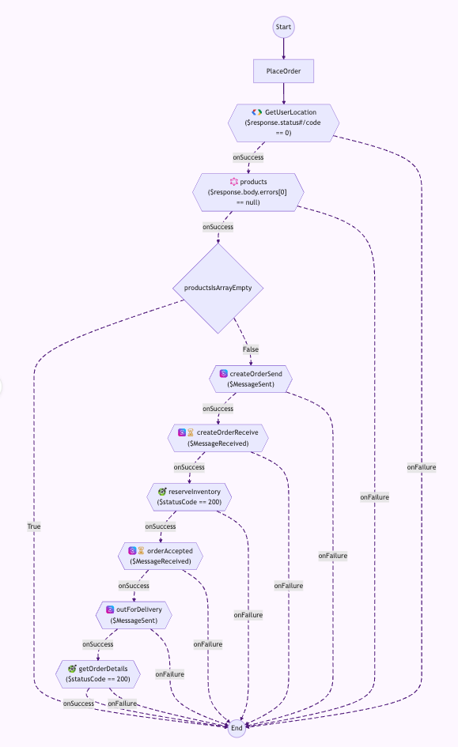

# Arazzo examples

Example specifications demonstrating an order placement workflow
across OpenAPI, AsyncAPI, GraphQL, and gRPC APIs using Arazzo.

The workflow is defined in [PlaceOrder.arazzo.yaml](PlaceOrder.arazzo.yaml), with
API specifications in the `openapi/`, `asyncapi/`, `graphql/`, and `grpc/` directories.

## Contact

- **Name:** Specmatic
- **Website:** https://specmatic.io
- **Email:** devs@specmatic.io
